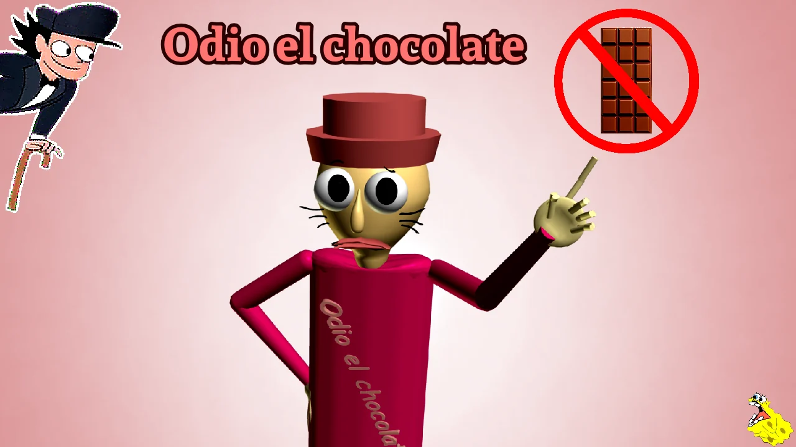
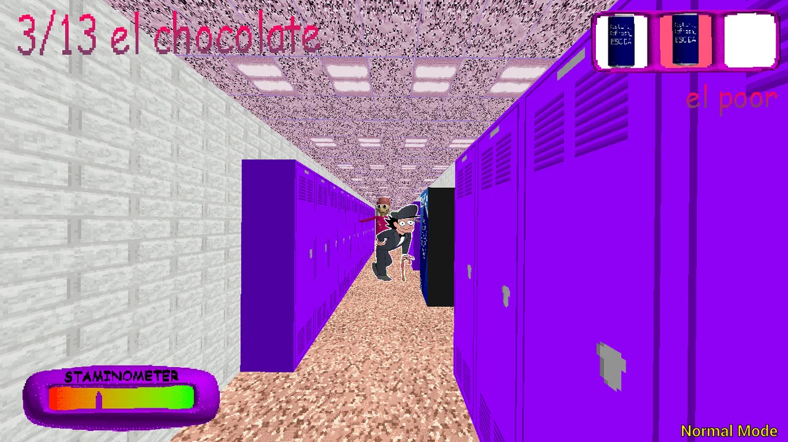
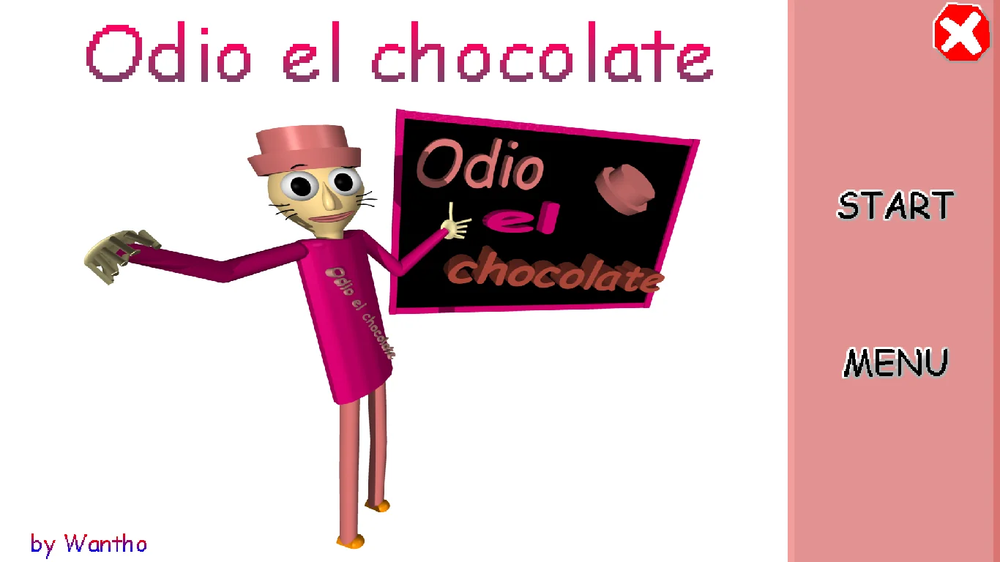

# Odio el Chocolate Games

[Visit Odio el Chocolate Games](https://odioelchocolate.games/)

## Explore the Website

Hosted at s.odioelchocolate.games · Touch joystick and buttons available. Not yet tested on physical Android phones; the initial download is large.

Odio el Chocolate—also searched as odioelchocolate—mixes the school-horror setting of a Baldi’s Basics mod with absurd humor. Wantho is the author of the published Windows and Android releases.

The browser host describes searching for chocolates through classrooms and corridors. Always check your edition’s instructions: we do not publish unverified routes or character behaviors.

These improvements apply to our web edition, not Wantho’s original APK. Stability and performance on physical Android phones still need validation; we do not promise crash-free play on every device.

Your task is not to memorize a story paragraph: it is to understand your mode, search the school and keep your next move clear. Main’s menu combines two tasks: collect 13 chocolates and get out. Reaching the target count does not replace any exit instructions that follow.

The title means “I hate chocolate,” yet chocolate is central to the search. Its scenes combine classrooms, corridors, exaggerated characters and visual jokes. If a video brought you here, learn the screen indicators before trying to imitate a fast run.

Group your search into areas: entrance, first corridor and connected rooms. This organizes exploration; it is not an official map. As you leave a room, remember which doorway you just checked.

Use the HUD number as your confirmation. A click and a nearby-looking object are not enough to establish a pickup. Our website checklist helps you record progress, but never reads or changes the game.

Before moving away, identify a landmark and the turn back. In Main, stay attentive after the last chocolate: follow your edition’s exit objective. A screenshot or a checklist with 13 marks is not a win.

The web edition includes a joystick, swipe turning and touch buttons. These have been tested in browser emulation, but not yet on physical Android phones. The Android edition is a separate download and the author warns of issues on some devices.

The game downloads external resources when started. A slow network, limited memory or browser restrictions can stop loading. Try the direct link or check the original downloads.

## Plan Your Visit

Images show counters of 3 and 13. Targets can change by stage; reaching 3/3 does not establish completion. Follow your edition’s counter and exit instructions. This site’s checklist is manual and adjustable.

No. Installation creates a shortcut and allows website content to be cached; the external game and videos still require Internet.

## Choose the right guide

The website provides Spanish and English sections so that you can read the guidance in the language you prefer. Begin with the homepage for the player and a short introduction, then move to the how to play section when you need more context. The modes section helps distinguish the options shown by the game. Original download references and Android information are separate topics, allowing visitors to compare editions without confusing a browser session with the author's native release.

Main, Low Cortisol, Baltazar and Triple Trouble appear in the site's mode guidance. Treat their names as a reason to check the relevant explanation, not as proof that every version contains identical behavior. The menu in your current edition is the practical reference when choosing how to play. If a screenshot and your own screen disagree, follow the current game instructions and avoid assuming that a route from another version will work unchanged.

## Use the tracker honestly

The chocolate tracker is a manual aid for organizing a search. Marking an item records your own observation; it does not collect a chocolate, unlock an exit or change a save. This distinction is especially important if you switch modes or adjust the target count. Use the counter inside the game to confirm actual progress, and use the website record only to help remember what you have checked.

For a first attempt, keep your plan small. Identify the room you entered, inspect it, and remember the way back before moving to the next area. This is an editorial practice suggestion rather than a verified winning route. The point is to reduce confusion, not to promise safety from every character. The school setting and humor can make a scene look familiar while the active mode changes what you need to do next.

## Understand the pictures

The gallery uses existing game images, including a cover, a school corridor and a menu view. Images associated with an original release are references to that release, not proof of current mobile performance. Counters, controls and presentation may differ between images. Look at the accompanying page context before treating one picture as a complete description of the version you are playing.

Odio el Chocolate Games is an independent fan website. It is not Wantho's official publication channel and is not affiliated with the creators of Baldi's Basics. Game names, characters and artwork remain associated with their respective owners. The site's purpose is to put play, reading and edition information within reach while making the limits clear. Return to the homepage to start a session, or use the English section if you want to continue reading in English.

## Visit Online

[Open Odio el Chocolate Games](https://odioelchocolate.games/) to explore the website and choose your next activity.
