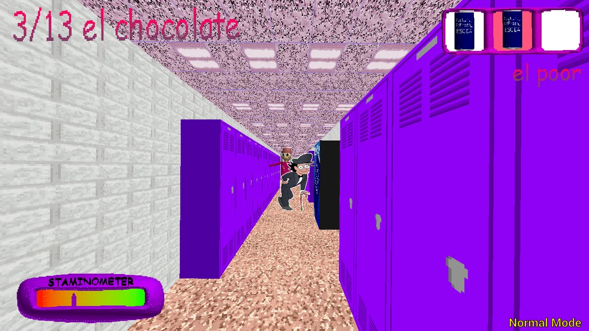

# Odio el Chocolate Games

**Explora la escuela, encuentra los chocolates y prepara tu próxima partida.**

[Odio el Chocolate Games](https://odioelchocolate.games/) reúne una versión de navegador del juego, guías visuales y enlaces a las publicaciones originales de Wantho. El sitio está disponible en español e inglés y organiza la información para que puedas pasar de la primera partida a una búsqueda más preparada.

## Descubre el sitio

- **[Jugar en el navegador](https://odioelchocolate.games/):** abre el juego, consulta la ayuda inicial y encuentra vídeos para conocer su ambiente.
- **[Cómo jugar](https://odioelchocolate.games/como-jugar/):** revisa los controles, aprende a leer el contador y el inventario, y practica con una lista de comprobación interactiva.
- **[Modos de juego](https://odioelchocolate.games/modos/):** conoce Main, Low Cortisol, Baltazar y Triple Trouble, y utiliza un registro manual para organizar tu búsqueda.
- **[Descargas originales](https://odioelchocolate.games/descargar/):** encuentra las publicaciones de Windows y Android, con orientación para preparar los archivos y empezar.
- **[Ayuda para Android](https://odioelchocolate.games/android/):** compara la aplicación nativa con el sitio instalado y consulta información sobre arquitectura, instalación y problemas de funcionamiento.
- **[Versión en inglés](https://odioelchocolate.games/en/):** explora las mismas secciones en inglés.

## Guías con imágenes y referencias

Las explicaciones combinan capturas del juego, pasos breves, preguntas desplegables y enlaces a sus fuentes. Los consejos distinguen entre lo que muestran los menús, las recomendaciones de práctica y las características que todavía necesitan comprobarse en cada versión. El contador puede variar según la fase: sigue siempre las indicaciones de tu partida.

## Una experiencia para consultar a tu ritmo

El sitio adapta su distribución a pantallas de ordenador y móvil. Para la edición de navegador se recomiendan teclado y ratón; sus controles táctiles no están verificados. La edición Android de Wantho es una descarga independiente. Instalar el sitio como acceso directo no instala ese APK ni añade controles al juego.

El juego externo y los vídeos necesitan conexión a Internet. Las listas del sitio son ayudas manuales: no leen ni modifican una partida guardada.

## Sobre este proyecto

Odio el Chocolate Games es un sitio independiente de fans, sin afiliación a Wantho ni a los creadores de Baldi’s Basics. El juego, sus personajes y sus imágenes pertenecen a sus respectivos titulares. Las capturas proceden de las publicaciones de Wantho y de odioelchocolate.org, con referencias en las páginas correspondientes.

[Sobre nosotros](https://odioelchocolate.games/acerca-de/) · [Contacto](https://odioelchocolate.games/contacto/) · [Privacidad](https://odioelchocolate.games/privacidad/) · [Términos de uso](https://odioelchocolate.games/terminos/)

Contacto: [mooyuking@gmail.com](mailto:mooyuking@gmail.com)
